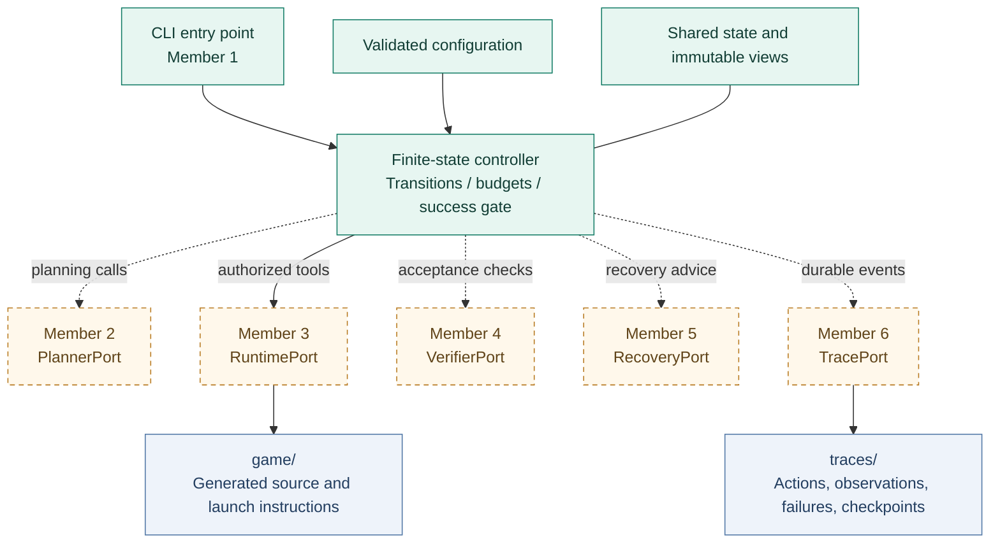
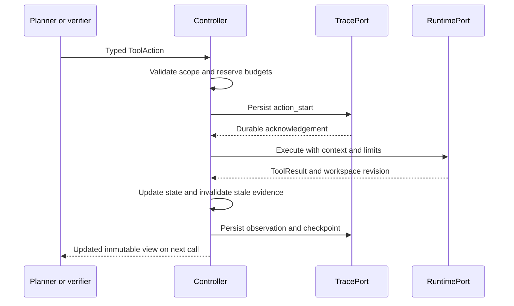
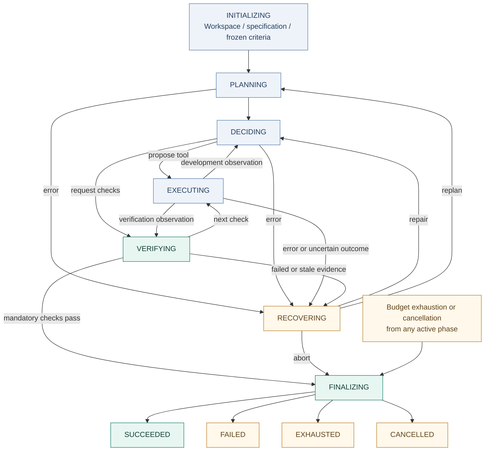

<div align="center">


# PE6203 Game Coding Agent

**An autonomous coding agent designed to build playable games from unseen Markdown specifications.**


[Quick start](#quick-start) &nbsp; / &nbsp; [Architecture](#architecture) &nbsp; / &nbsp; [Team contracts](INTERFACES.md) &nbsp; / &nbsp; [Test report](TEST_REPORT.md)

</div>

> [!IMPORTANT]
> **Current milestone: Member 1 harness and Member 3 local runtime implemented.** The entry point, controller, state models, configuration, mock-based tests, and the `RuntimePort` implementation are available. Production modules from Members 2, 4, 5, and 6 still need to be implemented and all real modules still need to be connected. The repository does not yet generate a real playable game.

## Project at a glance

| Input | Development process | Preserved output |
|---|---|---|
| An unseen `game_design_prompt.md` | Plan, propose, execute, observe, verify, and recover | Generated `game/` plus execution records in `traces/` |

The agent must start with one documented command and develop autonomously without manual fixes. The controller owns the workflow, validates proposed actions, enforces budgets, and permits success only when verification and delivery conditions hold.

```bash
python -m agent game_design_prompt.md
```

This is the required **production command after integration**. Before the real dependency factory exists, it deliberately reports an integration error rather than substituting mocks.

## Why the harness matters

| Capability | Implemented behavior |
|---|---|
| Explicit control flow | A finite-state machine defines legal transitions and terminal outcomes |
| Typed handoffs | Shared dataclasses and asynchronous protocols define module inputs and results |
| One tool gateway | File actions, commands, installs, and verification tools pass through the controller |
| Bounded execution | Time, step, command, retry, recovery, and no-progress limits stop runaway loops |
| Evidence before success | Reports must match the current specification, workspace, and acceptance suite |
| Provider independence | LLM and runtime modules are injected through a dependency factory |
| Artifact preservation | Existing non-empty game directories are protected; failures retain partial work |

## Quick start

### 1. Get the framework

Use **Python 3.11 or newer**. Member 1 has no third-party runtime dependencies.

```bash
git clone https://github.com/shirley830/6203-game-coding-agent.git
cd 6203-game-coding-agent
```

### 2. Run the available checks

```bash
python -m unittest discover -v
python -m agent --help
```

**Current result: 58 tests passed locally:** the original 43 tests use test doubles to validate the harness, and 15 Member 3 tests exercise the local runtime. These results do not yet validate real LLM output or game playability. See the [framework verification record](TEST_REPORT.md) and [Member 3 runtime report](MEMBER3_TEST_REPORT.md) for coverage and limits.

### 3. Connect the production modules

Member 1 will compose the real implementations through:

```text
create_dependencies(config) -> Dependencies
```

The returned object contains `planner`, `runtime`, `verifier`, `recovery`, and `tracer`. The default factory is `agent.integrations:create_dependencies`.

If the factory is in another module, configure it **before** the live run:

```bash
export AGENT_MODULE_FACTORY=your_team.integration:create_dependencies
python -m agent game_design_prompt.md
```

`your_team.integration` is a placeholder for the team's actual module. Alternatively, pass `--factory module:function`. The CLI factory option overrides the environment setting; budget flags override defaults. No external budget configuration file is read in this version.

## Architecture

The team builds six modules, while the runtime uses **one sequential controller**. Modules return proposals or observations; they do not mutate controller state.



**Green:** implemented framework. **Dashed amber:** production modules awaiting integration. Outputs shown are the intended integrated-system artifacts.

The controller decides **whether** an action can run. Member 3 determines **how** it runs and must enforce OS/process isolation. A working-directory setting alone is not a sandbox.

## One action through the system

The same gateway serves generation, verification, and repair tools:



A rejected proposal consumes a step but does not reach the runtime. A timeout or uncertain side effect invalidates old verification and cannot be blindly retried.

## Development workflow



This overview omits initialization-failure edges and safe retries back to the originating phase. [`TRANSITIONS`](agent/controller.py) is the authoritative transition table. Tool execution returns to the phase stored in `execution_return_phase`.

## The success gate

The model can request verification; it cannot declare success.

| Required condition | Controller check |
|---|---|
| Correct task | The report's specification digest matches the input |
| Current artifact | The report's workspace revision matches current state |
| Frozen criteria | The acceptance-suite version matches; every criterion has a result |
| Mandatory acceptance | Every mandatory result is PASS with non-empty evidence |
| Observed verification | At least one verification tool operation succeeded in this cycle |
| Launch information | A non-empty launch argument vector was supplied |
| Preserved delivery | game/ exists; TracePort confirms preservation in the correct directory; the terminal event is persisted |

Member 4 must establish actual startup, functionality, and interaction coverage. A process that starts without crashing is not enough to prove the game is playable.

## Budgets and outcomes

Defaults are tunable rehearsal settings, not assignment requirements.

| Limit | Default | CLI option |
|---|---:|---|
| Total runtime, including finalization | 900 s | `--max-runtime` |
| Work steps | 200 | `--max-steps` |
| Commands and dependency installations | 60 | `--max-commands` |
| Additional retries per operation | 2 | `--max-retries` |
| Global recovery attempts | 8 | `--max-recovery-attempts` |
| Model call timeout | 60 s | `--model-timeout` |
| Command timeout | 60 s | `--command-timeout` |
| Repeated no-progress cycles | 5 | `--max-no-progress` |
| Finalization reserve inside total runtime | 10 s | `--finalization-reserve` |
| Trace infrastructure timeout | 5 s | `--infrastructure-timeout` |

Each module call and tool attempt consumes a step. Rejected proposals and retries count; failure never refunds counters. Tracing has a timeout but does not consume steps. Alternating actions may evade the repetition heuristic, but global limits still apply.

| Outcome | Exit code | Meaning |
|---|---:|---|
| SUCCEEDED | 0 | Current acceptance and delivery conditions hold |
| FAILED | 1 | Unrecoverable failure, invalid evidence, or preservation failure |
| Startup/configuration error | 2 | Development did not start |
| EXHAUSTED | 3 | A budget or no-progress limit stopped development |
| CANCELLED | 130 | External cancellation or user interruption |

Runs return a JSON `RunSummary` with the reason, counters, artifact locations, launch command, and verification report. Non-success outcomes preserve existing work.

## Repository map

```text
6203-game-coding-agent/
├── agent/
│   ├── __init__.py
│   ├── __main__.py          # CLI and dependency-factory loading
│   ├── controller.py        # Protocols, state machine, and tool gateway
│   ├── state.py             # Shared data contracts and immutable views
│   ├── config.py            # Validated limits and paths
│   └── tools/               # Member 3 local RuntimePort implementation
├── assets/
│   └── readme-banner.svg    # Documentation artwork
├── tests/
│   ├── __init__.py
│   ├── test_controller.py   # Behavioral tests with injected fakes
│   ├── test_config_cli.py   # Configuration and entry-point tests
│   └── test_runtime.py      # Member 3 filesystem/process runtime tests
├── INTERFACES.md            # Team contract v1
├── TEST_REPORT.md           # Verified behavior and test limitations
├── MEMBER3_DECISIONS.md     # Runtime behavior and integration decisions
├── MEMBER3_TEST_REPORT.md   # Member 3 verification and rehearsal limits
├── README.md
├── pyproject.toml
└── .gitignore
```

Runtime outputs are separate from submitted Agent code:

```text
run-root/
├── agent/                  # Submitted Agent
├── game_design_prompt.md   # Unchanged input
├── game/                   # Generated source and launch documentation
└── traces/
    └── <run-id>/           # Durable record for this run
```

`run_root` defaults to the launch directory. With `--run-root`, relative specification paths are relative to that directory. Absolute specification paths are read-only input; tool file paths are relative to game/. An existing non-empty game/ is never overwritten.

> [!NOTE]
> game/ and traces/ are ignored during development, but they must be preserved and submitted after the assessed run. Git ignore rules are not permission to delete them. No game source or template is prewritten in this repository.

## Team implementation map

| Member | Ownership | Interface | Current repository status |
|---|---|---|---|
| **1** | Entry point, controller, state, configuration, and integration | Dependencies / Controller | Framework implemented |
| **2** | LLM, planning, prompts, and content generation | PlannerPort | Production implementation pending |
| **3** | Files, commands, dependencies, and runtime isolation | RuntimePort | Local implementation complete; integration and platform rehearsal pending |
| **4** | Game verification and acceptance testing | VerifierPort | Production implementation pending |
| **5** | Error recovery and evaluation | RecoveryPort | Production implementation pending |
| **6** | Tracing, logging, and delivery | TracePort | Production implementation pending |

Read [INTERFACES.md](INTERFACES.md) before implementation. Use the shared types in [state.py](agent/state.py) and asynchronous signatures in [controller.py](agent/controller.py). Coordinate shared-contract changes with Member 1.

When a module is ready, provide its import path, construction requirements, dependencies, and tests. Member 1 will compose the real objects and run full-system rehearsals. For Members 3 and 6, agree on raw-output storage and references; for Members 3 and 4, agree on workspace revisions and bounded game checks.

## Testing scope

The [43-test verification record](TEST_REPORT.md) covers:

- Current-revision acceptance, rejection of stale or missing evidence, and repair followed by fresh verification.
- Safe retry accounting and rejection of retries with unknown side effects.
- Time, step, command, recovery, and no-progress stopping conditions.
- Path traversal, symlink escape, verifier writes, and undeclared-argument rejection.
- Existing-artifact protection, cancellation, trace failure, and delivery failure.
- The required module entry point with an explicitly selected test factory.

Mocks exist only under tests/. They do not install dependencies, execute game code, or replace missing production adapters. Real LLM calls, OS isolation, game interaction, and durable production logging remain integration checks.

## Roadmap and practical limits

- [x] Define typed team contracts and immutable module views.
- [x] Implement the Member 1 finite-state controller and configurable budgets.
- [x] Enforce current-revision verification before success.
- [x] Validate the framework with 43 mock-based tests.
- [x] Implement and locally test the Member 3 runtime module.
- [ ] Implement the production modules for Members 2, 4, 5, and 6.
- [ ] Connect all production modules through the dependency factory.
- [ ] Rehearse autonomous development against varied unseen specifications.
- [ ] Verify real game launch, interactions, failure recovery, and submission artifacts.

<details>
<summary><strong>Runtime and persistence limitations</strong></summary>

Checkpoints are saved, but automatic resume is not implemented. Controller instances are single-use. Token and monetary budgets await the common model/API selection. Runtime execution is sequential.

Timeouts require cooperative asynchronous cancellation. asyncio cannot forcibly stop arbitrary blocking or cancellation-resistant code. Member 3 must use managed process/isolation boundaries; Member 2 must use cancellable network calls. A single Ctrl+C requests best-effort finalization; repeated forced interruption, kill -9, power loss, or disk failure can prevent the final record from being written.

TracePort.preserved=True must reflect actual persistence. The controller checks directory existence and path agreement, but storage durability belongs to Member 6. If the terminal event cannot be saved, the CLI returns FAILED while an earlier summary may contain the proposed outcome. Auditing must check terminal events too.

</details>

---

**PE6203 group project** - reusable Agent infrastructure, generated game artifacts, and a traceable autonomous development process.
