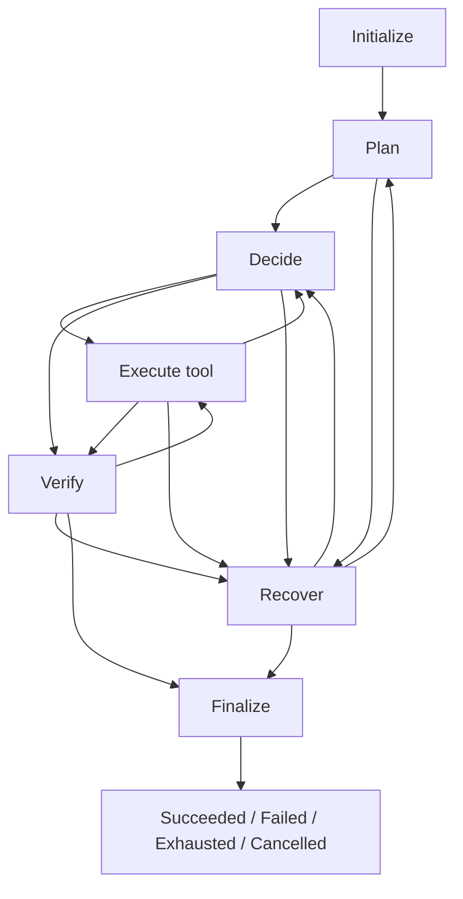

# 6203-game-coding-agent
An autonomous coding agent that builds playable games from unseen Markdown specifications.

This delivery implements the entry point, finite-state controller, shared state, and configuration. Other members implement the ports specified in INTERFACES.md and inject them. It contains no production LLM client, tool runtime, acceptance algorithm, recovery algorithm, trace storage implementation, game code, or game template.

## Delivered files

| File | Purpose |
|---|---|
| agent/__main__.py | Required module entry point, CLI, dependency loading, and exit codes |
| agent/controller.py | Five port protocols, dependency injection, transitions, tool gateway, budgets, and success gate |
| agent/state.py | Shared requests and results, immutable views, and serializable state |
| agent/config.py | Immutable policy configuration and validation |
| INTERFACES.md | Contract for other members |
| tests/ | Test-only mocks and behavioral tests |

## Environment and tests

Use Python 3.11 or newer. Member 1 has no third-party runtime dependencies. From the directory containing pyproject.toml:

```bash
python -m unittest discover -v
python -m agent --help
```

Passing tests does not mean a real game was generated. artifact.txt is a plain fixture marker, not game code. Tests clean up their temporary directories. Production run directories are never automatically deleted.

## Production execution after integration

Once the team supplies `agent.integrations:create_dependencies`, use the required command:

```bash
python -m agent game_design_prompt.md
```

If the factory lives elsewhere, configure it before the live run:

```bash
export AGENT_MODULE_FACTORY=your_team.integration:create_dependencies
python -m agent game_design_prompt.md
```

Alternatively use `--factory module:function`. The CLI factory option overrides the environment setting. Budget flags override defaults. This version does not read budget environment variables or external configuration files.

The synchronous factory receives AgentConfig and returns Dependencies containing planner, runtime, verifier, recovery, and tracer. Port methods are asynchronous; exact signatures are in controller.py. Implementation module names are unrestricted.

A missing factory exits with code 2 and an integration error. It never enables mocks. Missing production modules are an intentional boundary of this Member 1 delivery.

## Directories and paths

run_root defaults to the launch directory. Outputs are game/ and traces/<run_id>/. With --run-root, relative specification paths are relative to that directory. Absolute specification paths may point elsewhere and are read-only input. Development paths are relative to game/.

An existing non-empty game/ is never overwritten. Before the live run, prepare a fresh empty run directory and install the Agent. Preserve game/ and traces/ after assessment. No human repairs or dependency installation are permitted during execution.

## State machine



This overview omits safe-retry edges to the originating phase and budget/cancellation edges from all active phases to finalization. TRANSITIONS defines all legal edges. execution_return_phase determines the return from execution.

The controller persists action-start before invoking the runtime. It then updates state, stores the observation, and saves a checkpoint. Trace failure stops development. Recovery remains bounded by budgets and side-effect safety.

SUCCEEDED requires matching specification, workspace, and suite versions; PASS with evidence for every mandatory criterion; at least one controller-dispatched verification operation; an existing game directory; and confirmed trace preservation. The LLM has no direct completion interface.

## Default budgets

The total deadline is 900 seconds including a 10-second finalization reserve. Limits are 200 steps, 60 command attempts, two additional retries per operation, and eight global recovery attempts. Model and command timeouts default to 60 seconds; infrastructure timeouts default to five seconds.

Repeated identical ineffective actions can exhaust the no-progress limit. Alternating actions may evade this heuristic, but global step and time budgets still stop execution.

A module call or tool attempt consumes one step. Rejected proposals count. Commands and installations count before invocation; failures and retries do not refund counters. Modules see remaining limits without mutable budget access.

## Results and exit codes

Execution outputs a JSON RunSummary with outcome, reason, artifact locations, launch command, verification report, and counters.

| Exit code | Meaning |
|---|---|
| 0 | SUCCEEDED |
| 1 | FAILED |
| 2 | Argument, configuration, or dependency-factory error before development starts |
| 3 | EXHAUSTED |
| 130 | CANCELLED or user interruption |

A single Ctrl+C requests cancellation and best-effort finalization. Repeated forced interruption, kill -9, power loss, or disk failure can prevent the final record from being written. The controller never deletes saved artifacts.

## Team handoff

- Member 2 implements PlannerPort: plans, actions, content, and launch documentation.
- Member 3 implements RuntimePort: revisions, isolation, timeouts, process cleanup, and dependencies.
- Member 4 implements VerifierPort: specification-derived criteria, executable checks, and genuine evidence.
- Member 5 implements RecoveryPort: error classification and bounded recovery recommendations.
- Member 6 implements TracePort: durable events, checkpoints, full output, and delivery preservation.
- Member 1 wires these objects into the factory and conducts real end-to-end rehearsals after integration.

## Current limitations

Checkpoints are saved, but automatic resume is not implemented. Controller instances are single-use. Token and monetary budgets remain future extensions after the common API is selected. Parallel runtime agents are not implemented.

Timeouts require cooperative asynchronous cancellation. asyncio cannot forcibly stop arbitrary blocking or cancellation-resistant code. Member 3 must use managed process/isolation boundaries; Member 2 must use cancellable network calls. Real playability and evidence quality depend on Member 4. Structural and revision checks do not replace acceptance tests.

Member 6's preserved=True must represent actual persistence. The controller checks directory existence and matching paths but does not implement storage durability. If the terminal event cannot be saved, the CLI returns FAILED while an earlier summary may still show the proposed outcome. Auditing must check terminal events too.
