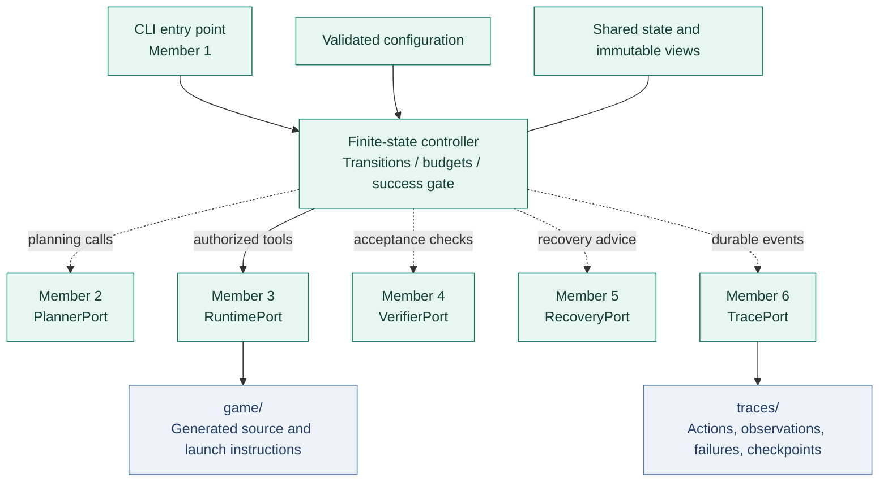
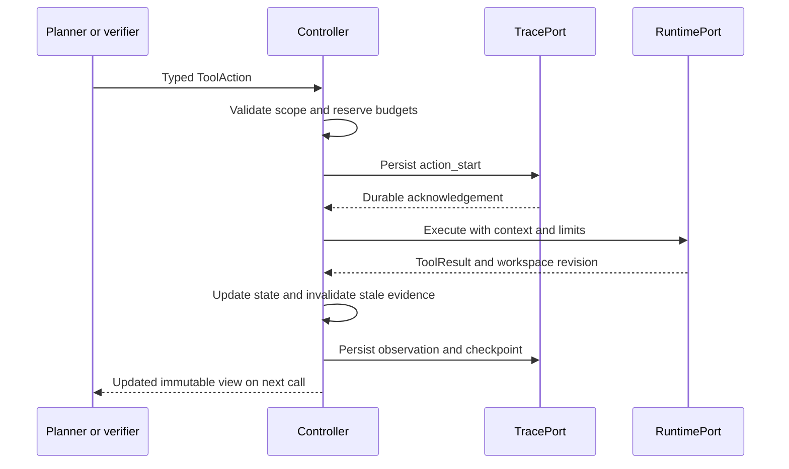
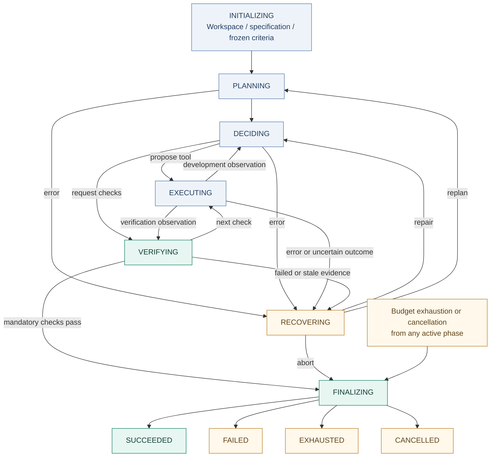

<div align="center">


<p><b>Give it one Markdown spec. Get back a playable game, the tests it passed,<br>and a trace of every decision along the way.</b></p>

<p>


</p>

<p>
<a href="#quick-start"><b>Quick start</b></a> &nbsp;·&nbsp;
<a href="#architecture"><b>Architecture</b></a> &nbsp;·&nbsp;
<a href="docs/testing/LIVE_MODEL_TESTS.md"><b>Live model tests</b></a> &nbsp;·&nbsp;
<a href="docs/INTERFACES.md"><b>Team contracts</b></a> &nbsp;·&nbsp;
<a href="docs/INTEGRATION_REVIEW_CN.md"><b>Integration review</b></a>
</p>

</div>

## At a glance

<table>
<tr>
<td width="33%" valign="top">

**📄 In**

One unseen `game_design_prompt.md`, nothing else.

```bash
python -m agent game_design_prompt.md
```

</td>
<td width="33%" valign="top">

**⚙️ Process**

Freeze executable acceptance tests from the spec, plan, write code in a sandbox, test the game in a real browser, repair or replan on failure, all within time, step and retry budgets.

</td>
<td width="33%" valign="top">

**📦 Out**

`game/`: a playable game with a documented launch command.<br>
`traces/<run_id>/`: every action, decision, failure and recovery, with screenshots and a readable `run_report.md`.

</td>
</tr>
</table>

<table>
<tr><td><b>Status</b></td><td>All six modules integrated · 199 tests passing · 23 live runs on 3 models (<a href="docs/testing/LIVE_MODEL_TESTS.md">results</a>)</td></tr>
<tr><td><b>Success means</b></td><td>Every mandatory criterion passes on the current code, with evidence; nothing else counts</td></tr>
<tr><td><b>Never</b></td><td>Mocks in the production path, edits to <code>agent/</code> or the spec during a run, deleting earlier <code>game/</code> or <code>traces/</code></td></tr>
<tr><td><b>Still to do</b></td><td>Rehearse with the course-provided model · write <code>report.pdf</code></td></tr>
</table>

## Why the harness matters

| Capability | Implemented behavior |
|---|---|
| Explicit control flow | A finite-state machine defines legal transitions and terminal outcomes |
| Typed handoffs | Shared dataclasses and asynchronous protocols define module inputs and results |
| One tool gateway | File actions, commands, installs, and verification tools pass through the controller |
| Bounded execution | Time, step, command, retry, recovery, and no-progress limits stop runaway loops |
| Evidence before success | Reports must match the current specification, workspace, and acceptance suite |
| Provider independence | LLM and runtime modules are injected through a dependency factory |
| Artifact preservation | Existing non-empty game directories are protected; failures retain partial work |

## Quick start

### 1. Install (once, before the presentation)

Python **3.11+** on macOS (uses `sandbox-exec`) or Linux with `bwrap` installed.

```bash
git clone https://github.com/shirley830/6203-game-coding-agent.git
cd 6203-game-coding-agent
python3 -m venv .venv && source .venv/bin/activate
pip install -e ".[test]"
python -m playwright install chromium-headless-shell
```

### 2. Configure the model (`agent.env`)

Put an `agent.env` file in the run directory, next to `game_design_prompt.md` (template: [agent.env.example](agent.env.example)):

```text
AGENT_MODEL=openai/course-model-name      # any LiteLLM model name
AGENT_API_BASE=https://course-endpoint/v1 # optional custom endpoint
OPENAI_API_KEY=...                        # the provider's own key variable
```

Add `AGENT_MAX_RUNTIME=<seconds>` to fit the presentation slot (default 1800, includes finalization); the agent prints the latest time it will stop. Shell variables override the file, and `--env-file PATH` selects another file. Only key names are printed, never values. Generated code cannot read `agent.env`: the command sandbox blocks it. **Never commit or submit `agent.env`.**

### 3. Check the machine, then run

```bash
python -m agent.preflight        # READY / NOT READY, run on the demo machine beforehand
python -m agent game_design_prompt.md
```

The agent runs the same self-check at startup. If something that makes success impossible is missing (Playwright Chromium, the command sandbox, a free port 8000, python3), it stops **before** creating `game/` and says why. Other findings, such as "node is not installed", are passed to the planner so it never plans commands that cannot run.

Model calls that fail transiently (connection errors, rate limits, 5xx) are retried up to 5 times, waiting 5s, 15s, 45s, then 60s before each retry, always within the total time budget. Each wait is recorded as a `retry_backoff` event in the trace.

Games are built for the browser unless the specification explicitly asks for something else. Terminal and pygame-style Python games (launch `python3 main.py`) are verified in process mode: the program must start and keep running without a traceback; terminal games are played by typing moves; graphical games run headless and their input handling is checked statically (labelled as such in the trace). Spec-derived scenarios apply to browser games only.

The agent creates `game/` (with `README.md` and the launch command), `traces/<run_id>/` and `.agent-runtime/`. Start the generated game with the command in `game/README.md`, normally `cd game && python3 -m http.server 8000 --bind 127.0.0.1`, then open http://127.0.0.1:8000/.

### 4. Checks and offline rehearsal

```bash
python -m pytest -q                                   # 199 tests incl. end-to-end
PYTHONPATH=<repo> python -m agent game_design_prompt.md \
    --factory tests.rehearsal_factory:create_dependencies   # no API key needed
python -m agent.delivery traces/<run_id>              # audit a finished trace
```

The rehearsal factory lives under `tests/` and uses a scripted model client; it is never the default.

## Architecture

The team builds six modules, while the runtime uses **one sequential controller**. Modules return proposals or observations; they do not mutate controller state.



All ports are wired by `agent/integrations.py:create_dependencies`.

The controller decides **whether** an action can run. Member 3 determines **how** it runs and must enforce OS/process isolation. A working-directory setting alone is not a sandbox.

## One action through the system

The same gateway serves generation, verification, and repair tools:



A rejected proposal consumes a step but does not reach the runtime. A timeout or uncertain side effect invalidates old verification and cannot be blindly retried.

## Development workflow



This overview omits initialization-failure edges and safe retries back to the originating phase. [`TRANSITIONS`](agent/controller.py) is the authoritative transition table. Tool execution returns to the phase stored in `execution_return_phase`.

## The success gate

The model can request verification; it cannot declare success.

| Required condition | Controller check |
|---|---|
| Correct task | The report's specification digest matches the input |
| Current artifact | The report's workspace revision matches current state |
| Frozen criteria | The acceptance-suite version matches; every criterion has a result |
| Mandatory acceptance | Every mandatory result is PASS with non-empty evidence |
| Observed verification | At least one verification tool operation succeeded in this cycle |
| Launch information | A non-empty launch argument vector was supplied |
| Preserved delivery | game/ exists; TracePort confirms preservation in the correct directory; the terminal event is persisted |

Member 4 must establish actual startup, functionality, and interaction coverage. A process that starts without crashing is not enough to prove the game is playable.

## Budgets and outcomes

Defaults are tunable rehearsal settings, not assignment requirements.

| Limit | Default | CLI option |
|---|---:|---|
| Total runtime, including finalization | 900 s | `--max-runtime` |
| Work steps | 200 | `--max-steps` |
| Commands and dependency installations | 60 | `--max-commands` |
| Additional retries per operation | 2 | `--max-retries` |
| Global recovery attempts | 8 | `--max-recovery-attempts` |
| Model call timeout | 60 s | `--model-timeout` |
| Command timeout | 60 s | `--command-timeout` |
| Repeated no-progress cycles | 5 | `--max-no-progress` |
| Finalization reserve inside total runtime | 10 s | `--finalization-reserve` |
| Trace infrastructure timeout | 5 s | `--infrastructure-timeout` |

Each module call and tool attempt consumes a step. Rejected proposals and retries count; failure never refunds counters. Tracing has a timeout but does not consume steps. Alternating actions may evade the repetition heuristic, but global limits still apply.

| Outcome | Exit code | Meaning |
|---|---:|---|
| SUCCEEDED | 0 | Current acceptance and delivery conditions hold |
| FAILED | 1 | Unrecoverable failure, invalid evidence, or preservation failure |
| Startup/configuration error | 2 | Development did not start |
| EXHAUSTED | 3 | A budget or no-progress limit stopped development |
| CANCELLED | 130 | External cancellation or user interruption |

Runs return a JSON `RunSummary` with the reason, counters, artifact locations, launch command, and verification report. Non-success outcomes preserve existing work.

## Repository map

```text
6203-game-coding-agent/
├── agent/
│   ├── __init__.py
│   ├── __main__.py          # CLI and dependency-factory loading
│   ├── controller.py        # Protocols, state machine, and tool gateway
│   ├── state.py             # Shared data contracts and immutable views
│   ├── config.py            # Validated limits and paths
│   ├── integrations.py      # Production dependency factory (Member 1)
│   ├── planning/            # Member 2 LLM planner, prompts, parser
│   ├── tools/               # Member 3 sandboxed runtime
│   ├── verification/        # Member 4 GameVerifier + playwright_game_check.py
│   ├── recovery/            # Member 5 recovery policy
│   ├── tracing/             # Member 6 recorder + run_report.md renderer
│   └── delivery.py          # Member 6 trace audit
├── evaluation/              # Member 5 offline evaluation specs and report
├── assets/
│   └── readme-banner.svg    # Documentation artwork
├── tests/
│   ├── __init__.py
│   ├── test_controller.py   # Behavioral tests with injected fakes
│   ├── test_config_cli.py   # Configuration and entry-point tests
│   ├── test_runtime.py      # Member 3 real runtime tests
│   ├── test_runtime_process_cleanup.py # Process cleanup and uncertainty regressions
│   ├── test_planner.py / test_recovery.py / test_tracing.py / test_evaluation.py
│   ├── test_verifier_member4.py
│   ├── test_integration_tasks.py   # Cross-member checklist + end-to-end rehearsal
│   └── rehearsal_factory.py        # Scripted-model factory (tests only)
├── docs/
│   ├── INTERFACES.md        # Team contract v1
│   ├── INTEGRATION_REVIEW_CN.md  # Integration review and remaining work
│   ├── members/             # Each member's delivery notes and decisions
│   └── testing/             # Test overview (README.md), LIVE_MODEL_TESTS.md, historical records
├── README.md
├── pyproject.toml
└── .gitignore
```

Runtime outputs are separate from submitted Agent code:

```text
run-root/
├── agent/                  # Submitted Agent
├── game_design_prompt.md   # Unchanged input
├── game/                   # Generated source and launch documentation
├── .agent-runtime/         # Isolated dependency environments and default raw output
└── traces/
    └── <run-id>/           # Durable record for this run
```

`run_root` defaults to the launch directory. With `--run-root`, relative specification paths are relative to that directory. Absolute specification paths are read-only input; tool file paths are relative to game/. An existing non-empty game/ is never overwritten.

> [!NOTE]
> game/ and traces/ are ignored during development, but they must be preserved and submitted after the assessed run. Preserve referenced raw output and the managed environment under .agent-runtime/ too, or arrange trace-owned raw output and a documented reproducible dependency setup. Git ignore rules are not permission to delete them. No game source or template is prewritten in this repository.

## Evidence flow

Verification screenshots and logs are written by the harness into a per-command `AGENT_ARTIFACT_DIR` inside `.agent-runtime/` (the sandbox allows writes there, not to `traces/`), returned as `output_refs`, and copied by the tracer into `traces/<run_id>/outputs/` with an index. `game/` never receives evidence, so the workspace revision verified is the revision delivered.

## Team implementation map

| Member | Ownership | Interface | Current repository status |
|---|---|---|---|
| **1** | Entry point, controller, state, configuration, and integration | Dependencies / Controller | Framework implemented |
| **2** | LLM, planning, prompts, and content generation | PlannerPort | Integrated (`agent/planning`) |
| **3** | Files, commands, dependencies, and runtime isolation | RuntimePort | Integrated (`agent/tools`) |
| **4** | Game verification and acceptance testing | VerifierPort | Integrated (`agent/verification`) |
| **5** | Error recovery and evaluation | RecoveryPort | Integrated (`agent/recovery`, `evaluation/`) |
| **6** | Tracing, logging, and delivery | TracePort | Integrated (`agent/tracing`, `agent/delivery.py`) |

Read [docs/INTERFACES.md](docs/INTERFACES.md) before implementation. Use the shared types in [state.py](agent/state.py) and asynchronous signatures in [controller.py](agent/controller.py). Coordinate shared-contract changes with Member 1.

When a module is ready, provide its import path, construction requirements, dependencies, and tests. Member 1 will compose the real objects and run full-system rehearsals. For Members 3 and 6, agree on raw-output storage and references; for Members 3 and 4, agree on workspace revisions and bounded game checks.

## Testing scope

The [Member 1 verification record](docs/testing/MEMBER1_TEST_REPORT.md) covers the controller; the full suite is 199 tests, listed by area in [docs/testing/README.md](docs/testing/README.md). Controller tests cover:

- Current-revision acceptance, rejection of stale or missing evidence, and repair followed by fresh verification.
- Safe retry accounting and rejection of retries with unknown side effects.
- Time, step, command, recovery, and no-progress stopping conditions.
- Path traversal, symlink escape, verifier writes, and undeclared-argument rejection.
- Existing-artifact protection, cancellation, trace failure, and delivery failure.
- The required module entry point with an explicitly selected test factory.

Live runs against real models (21 runs, 3 models, 4 rounds) are documented in [docs/testing/LIVE_MODEL_TESTS.md](docs/testing/LIVE_MODEL_TESTS.md).

Mocks exist only under tests/. They do not install dependencies, execute game code, or replace missing production adapters. Real LLM calls, OS isolation, game interaction, and durable production logging remain integration checks.

## Roadmap and practical limits

- [x] Define typed team contracts and immutable module views.
- [x] Implement the Member 1 finite-state controller and configurable budgets.
- [x] Enforce current-revision verification before success.
- [x] Validate the framework with 43 mock-based tests.
- [x] Integrate Member 3 files, tests, and packaging locally for review.
- [x] Fix Member 3 process-group cleanup and pass all 65 integration tests.
- [x] Implement and connect remaining production ports.
- [x] Offline end-to-end rehearsal (scripted model, real runtime/verifier/recovery/tracing).
- [ ] Rehearse with the course-provided model against varied unseen specifications.
- [ ] Verify real game launch, interactions, failure recovery, and submission artifacts.

<details>
<summary><strong>Runtime and persistence limitations</strong></summary>

Checkpoints are saved, but automatic resume is not implemented. Controller instances are single-use. Token and monetary budgets await the common model/API selection. Runtime execution is sequential.

Timeouts require cooperative asynchronous cancellation. asyncio cannot forcibly stop arbitrary blocking or cancellation-resistant code. Member 3 must use managed process/isolation boundaries; Member 2 must use cancellable network calls. A single Ctrl+C requests best-effort finalization; repeated forced interruption, kill -9, power loss, or disk failure can prevent the final record from being written.

TracePort.preserved=True must reflect actual persistence. The controller checks directory existence and path agreement, but storage durability belongs to Member 6. If the terminal event cannot be saved, the CLI returns FAILED while an earlier summary may contain the proposed outcome. Auditing must check terminal events too.

</details>

---

**PE6203 group project** - reusable Agent infrastructure, generated game artifacts, and a traceable autonomous development process.
