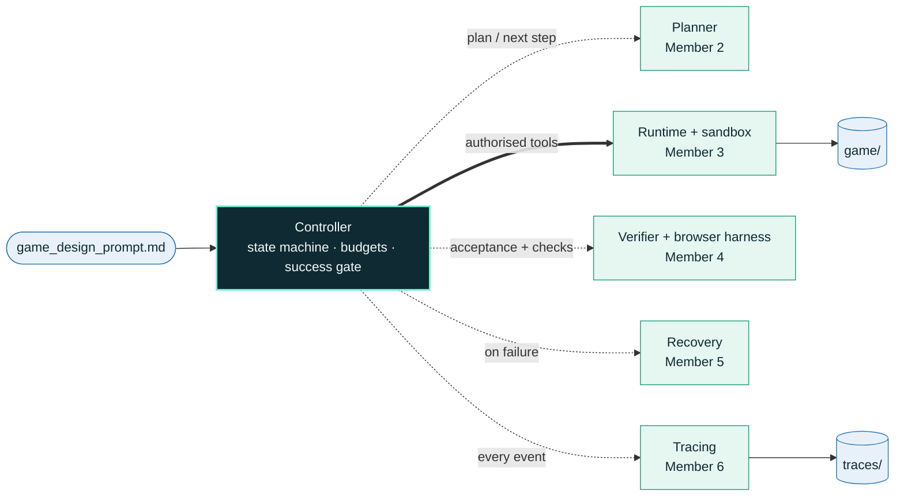
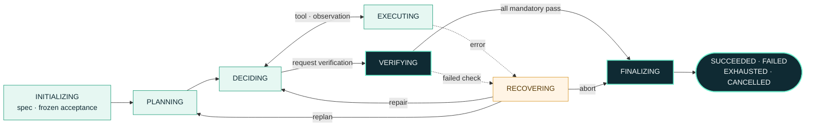
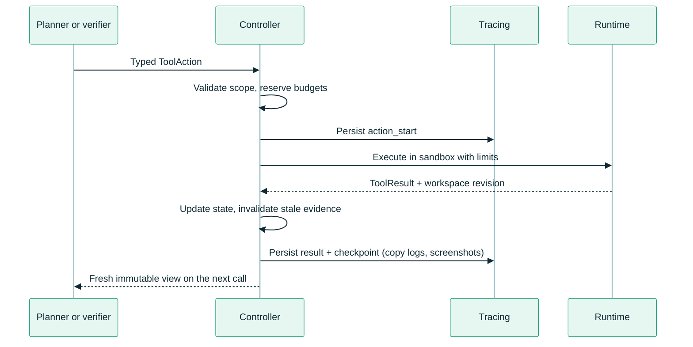

<div align="center">


<p><b>Give it one Markdown spec. Get back a playable game, the tests it passed,<br>and a trace of every decision along the way.</b></p>

<p>


</p>

<p>
<a href="#quick-start"><b>Quick start</b></a> &nbsp;·&nbsp;
<a href="#architecture"><b>Architecture</b></a> &nbsp;·&nbsp;
<a href="docs/testing/LIVE_MODEL_TESTS.md"><b>Live model tests</b></a> &nbsp;·&nbsp;
<a href="docs/INTERFACES.md"><b>Team contracts</b></a> &nbsp;·&nbsp;
<a href="docs/INTEGRATION_REVIEW_CN.md"><b>Integration review</b></a>
</p>

</div>

## At a glance

<table>
<tr>
<td width="33%" valign="top">

**📄 In**

One unseen `game_design_prompt.md`, nothing else.

```bash
python -m agent game_design_prompt.md
```

</td>
<td width="33%" valign="top">

**⚙️ Process**

Freeze executable acceptance tests from the spec, plan, write code in a sandbox, test the game in a real browser, repair or replan on failure, all within time, step and retry budgets.

</td>
<td width="33%" valign="top">

**📦 Out**

`game/`: a playable game with a documented launch command.<br>
`traces/<run_id>/`: every action, decision, failure and recovery, with screenshots and a readable `run_report.md`.

</td>
</tr>
</table>

<table>
<tr><td><b>Status</b></td><td>All six modules integrated · 199 tests passing · 23 live runs on 3 models (<a href="docs/testing/LIVE_MODEL_TESTS.md">results</a>)</td></tr>
<tr><td><b>Success means</b></td><td>Every mandatory criterion passes on the current code, with evidence; nothing else counts</td></tr>
<tr><td><b>Never</b></td><td>Mocks in the production path, edits to <code>agent/</code> or the spec during a run, deleting earlier <code>game/</code> or <code>traces/</code></td></tr>
<tr><td><b>Still to do</b></td><td>Rehearse with the course-provided model · write <code>report.pdf</code></td></tr>
</table>

## Quick start

<table>
<tr>
<td width="50%" valign="top">

**1 · Install once**

Python 3.11+ on macOS (`sandbox-exec`) or Linux with `bwrap`.

```bash
git clone https://github.com/shirley830/6203-game-coding-agent.git
cd 6203-game-coding-agent
python3 -m venv .venv && source .venv/bin/activate
pip install -e ".[test]"
python -m playwright install chromium-headless-shell
```

</td>
<td width="50%" valign="top">

**2 · Configure the model**

`agent.env` next to the spec ([template](agent.env.example)):

```text
AGENT_MODEL=openai/<model>
AGENT_API_BASE=https://…/v1
OPENAI_API_KEY=…
AGENT_MAX_RUNTIME=1200
```

Any LiteLLM model name; the key uses the provider's own variable.

</td>
</tr>
<tr>
<td width="50%" valign="top">

**3 · Check the machine, then run**

```bash
python -m agent.preflight
python -m agent game_design_prompt.md
```

The preflight prints `READY` or what is missing. The agent repeats it at start-up and stops **before** creating `game/` if success would be impossible.

</td>
<td width="50%" valign="top">

**4 · Play and inspect**

```bash
cd game
python3 -m http.server 8000
```

The exact command is always in `game/README.md`; `traces/<run_id>/run_report.md` tells the story of the run.

</td>
</tr>
</table>

> [!WARNING]
> `agent.env` holds your API key. Never commit or submit it. Only key **names** are printed, and generated code cannot read the file: the command sandbox blocks it.

> [!TIP]
> No API key yet? Rehearse the whole pipeline with a scripted model (real sandbox, browser, recovery and tracing):
> `PYTHONPATH=<repo> python -m agent game_design_prompt.md --factory tests.rehearsal_factory:create_dependencies`

## How it works

One sequential **controller** owns every decision about *whether* something may happen. Six modules propose, execute, check and record; none of them can change controller state or declare success.



<table>
<tr>
<td width="33%" valign="top">

**Explicit control**

A finite-state machine with legal transitions only; typed, immutable views go to every module; one gateway for every file write, command and install.

</td>
<td width="33%" valign="top">

**Bounded by design**

Time, step, command, retry, recovery and no-progress limits; transient model errors wait (5 s, 15 s, 45 s, 60 s) before retrying; nothing with unknown side effects is ever retried blindly.

</td>
<td width="33%" valign="top">

**Evidence before success**

Success needs passing, evidenced checks for the **current** code and spec, a launch command, and a durable trace. The model can ask for verification; it cannot declare success.

</td>
</tr>
</table>

## How a game is verified

The verifier writes the tests **before** any code exists, from the specification alone, then runs them against the real game in headless Chromium.

<table>
<tr>
<td width="33%" valign="top">

**① Freeze acceptance**

Before planning, one model call turns the spec into a *state contract* (`window.__gameState`, setup hooks) and 3-10 executable scenarios. Invalid or unpassable scenarios are dropped; the rest are frozen.

</td>
<td width="33%" valign="top">

**② Play the game**

The harness starts the documented launch command, presses real keys, clicks real cells and buttons, and checks the state after each step, with a screenshot per scenario.

</td>
<td width="33%" valign="top">

**③ Gate or repair**

All mandatory criteria pass → success. Otherwise the failing step and the state after it go back to the planner, which must fix the real defect, never bend the game to the check.

</td>
</tr>
</table>

| A scenario from a real run | Result |
|---|---|
| `placePlayerAt(2,2); placeEnemyAt(3,2); key ArrowRight; expect s.status === 'lost'` | ❌ turn-based game: caught "walking into the enemy does not lose", which generic checks had passed |
| `click_cell [0,0]; click_cell [1,0]; click_cell [2,0]; expect s.cards[2].faceUp === false` | ✅ mouse-only memory game: flips are blocked during the mismatch delay, verified by real clicks |

<details>
<summary><b>The success gate, condition by condition</b></summary>

| Required condition | Controller check |
|---|---|
| Correct task | The report's specification digest matches the input |
| Current artifact | The report's workspace revision matches the current workspace |
| Frozen criteria | The acceptance-suite version matches; every criterion has a result |
| Mandatory acceptance | Every mandatory result is PASS with non-empty evidence |
| Observed verification | At least one verification tool operation succeeded in this cycle |
| Launch information | A non-empty launch argument vector was supplied |
| Preserved delivery | `game/` exists; the tracer confirms preservation; the terminal event is durable |

</details>

<details>
<summary><b>Non-browser games (terminal, pygame)</b></summary>

Games are built for the browser unless the specification explicitly asks otherwise. Python games (`python3 main.py`) are verified in **process mode**: the program must start and keep running without a traceback; terminal games are played by typing moves on standard input; graphical games run headless (SDL dummy driver) and their input handling is checked statically, labelled as such in the trace. Spec-derived scenarios apply to browser games only.

</details>

## Inside a run



Verification checks also run through EXECUTING, and errors while planning or deciding also go to RECOVERING. Budget exhaustion or cancellation goes straight to FINALIZING from any phase.

<details>
<summary><b>One tool action through the system</b></summary>



A rejected proposal costs a step but never reaches the runtime. A timeout or uncertain side effect invalidates earlier verification and is never retried blindly. [`TRANSITIONS`](agent/controller.py) is the authoritative state table.

</details>

## What a run leaves behind

```text
run/
├── game_design_prompt.md   input, never modified
├── agent.env               model settings (never submitted)
├── game/                   the generated game + README.md with the launch command
├── traces/<run_id>/        the record of this run (below)
└── .agent-runtime/         isolated dependencies and raw command output
```

Existing `game/` or `traces/` content is never overwritten or deleted, whatever the outcome.

| `traces/<run_id>/` | Contents |
|---|---|
| `run_report.md` | Readable timeline with each action's rationale, frozen criteria, plans, verification cycles, model usage |
| `events.jsonl` | Every event in order, durable on write |
| `evidence/` | Screenshots from each verification, with a sha256 index |
| `verification/` | Every verification report |
| `model_usage.jsonl` | Tokens, latency and cost per model call |
| `checkpoints.jsonl` · `summary.json` | State history and the final outcome |

> [!NOTE]
> `python -m agent.delivery traces/<run_id>` audits a finished trace: contiguous events, a terminal event, and every referenced screenshot present with a matching hash.

## Budgets and outcomes

Defaults suit a 30-minute run; set `AGENT_MAX_RUNTIME` in `agent.env` to fit the presentation slot.

<details>
<summary><b>All limits and their options</b></summary>

| Limit | Default | Option |
|---|---:|---|
| Total runtime, including finalization | 1800 s | `AGENT_MAX_RUNTIME` or `--max-runtime` |
| Work steps | 200 | `--max-steps` |
| Commands and dependency installs | 80 | `--max-commands` |
| Additional retries per operation | 5 | `--max-retries` |
| Wait before the first retry (×3 each time, max 60 s) | 5 s | `--retry-backoff` |
| Global recovery attempts | 20 | `--max-recovery-attempts` |
| Model call timeout | 240 s | `--model-timeout` |
| Command timeout | 90 s | `--command-timeout` |
| Repeated no-progress cycles | 5 | `--max-no-progress` |
| Finalization reserve inside the runtime | 20 s | `--finalization-reserve` |
| Trace infrastructure timeout | 5 s | `--infrastructure-timeout` |

Every module call and tool attempt consumes a step, including rejected proposals and retries; failures never refund counters. After 8 consecutive edits without a verification, the planner requests one itself.

</details>

| Outcome | Exit code | Meaning |
|---|:---:|---|
| `SUCCEEDED` | 0 | Every mandatory criterion passes on the current code; delivery preserved |
| `FAILED` | 1 | Unrecoverable failure, invalid evidence or preservation failure |
| startup error | 2 | Development never started (for example no model configured, preflight failed) |
| `EXHAUSTED` | 3 | A budget or the no-progress limit stopped development |
| `CANCELLED` | 130 | External cancellation or Ctrl+C |

## Team

| Member | Module | Code | Notes |
|:---:|---|---|---|
| **1** | Controller, CLI, configuration, integration | `agent/controller.py` · `agent/integrations.py` | [Team contracts](docs/INTERFACES.md) |
| **2** | Planning, prompts, model client | `agent/planning/` | |
| **3** | Tools, sandbox, processes, dependencies | `agent/tools/` | [notes](docs/members/member3-runtime/) |
| **4** | Acceptance, spec scenarios, browser harness | `agent/verification/` | [notes](docs/members/member4-verification/) |
| **5** | Recovery policy, offline evaluation | `agent/recovery/` · `evaluation/` | [notes](docs/members/member5-recovery/) |
| **6** | Tracing, run report, delivery audit | `agent/tracing/` · `agent/delivery.py` | |

<details>
<summary><b>Repository map</b></summary>

```text
6203-game-coding-agent/
├── agent/                      the submitted agent (no game code)
│   ├── __main__.py             CLI: python -m agent game_design_prompt.md
│   ├── controller.py           state machine, tool gateway, success gate
│   ├── state.py · config.py    shared contracts, validated limits
│   ├── integrations.py         production wiring of the six modules
│   ├── preflight.py            start-up self-check (python -m agent.preflight)
│   ├── envfile.py              agent.env loading
│   ├── planning/               planner, prompts, parser, LiteLLM client
│   ├── tools/                  sandboxed runtime: files, commands, processes, deps
│   ├── verification/           verifier, spec scenarios, Playwright harness
│   ├── recovery/               error classification and recovery policy
│   ├── tracing/                recorder, run report, model usage
│   └── delivery.py             trace audit
├── evaluation/                 evaluation specs and run-record report
├── tests/                      199 tests; fixtures/ holds test-only pages
├── docs/                       contracts, integration review, member notes, testing
├── assets/readme-banner.svg
├── agent.env.example
└── pyproject.toml
```

</details>

## Testing

<table>
<tr>
<td width="33%" valign="top">

**199 tests**

Controller, tools, sandbox, planner, verifier, recovery, tracing, and real Playwright runs against fixture games. [By area →](docs/testing/README.md)

</td>
<td width="33%" valign="top">

**Offline rehearsal**

Real sandbox, browser, recovery and tracing with a scripted model: a broken game fails verification, is repaired, and passes.

</td>
<td width="33%" valign="top">

**23 live runs**

Three real models, four rounds of fixes driven by the traces, plus a terminal game. [Results →](docs/testing/LIVE_MODEL_TESTS.md)

</td>
</tr>
</table>

```bash
python -m pytest -q
```

---

<div align="center">
<sub><b>PE6203 Generative and Agentic AI · group project</b><br>
Agent code in <code>agent/</code> · games are generated live, never pre-written</sub>
</div>
