<div align="center">


<p><b>Give it one Markdown spec. Get back a playable game, the tests it passed,<br>and a trace of every decision along the way.</b></p>

<p>


</p>

<p>
<a href="#quick-start"><b>Quick start</b></a> &nbsp;·&nbsp;
<a href="#games"><b>Games</b></a> &nbsp;·&nbsp;
<a href="#how-it-works"><b>How it works</b></a> &nbsp;·&nbsp;
<a href="#verification"><b>Verification</b></a> &nbsp;·&nbsp;
<a href="docs/testing/LIVE_MODEL_TESTS.md"><b>Live model tests</b></a> &nbsp;·&nbsp;
<a href="docs/INTERFACES.md"><b>Team contracts</b></a>
</p>

</div>


<table>
<tr><td><b>Status</b></td><td>All six modules integrated · 298 tests passing · 48 live runs on 5 models · course model Kimi K3 (<a href="docs/testing/LIVE_MODEL_TESTS.md">results</a>)</td></tr>
<tr><td><b>Success means</b></td><td>Every mandatory criterion passes on the current code, with evidence; nothing else counts</td></tr>
<tr><td><b>Never</b></td><td>Mocks in the production path, edits to <code>agent/</code> or the spec during a run, deleting earlier <code>game/</code> or <code>traces/</code></td></tr>
<tr><td><b>Submission</b></td><td><a href="agent/">agent/</a> (with <a href="agent/README.md">README</a>) · <code>game/</code> and <code>traces/</code> from the assessed run at the presentation · <a href="report.pdf">report.pdf</a></td></tr>
<tr><td><b>Report</b></td><td><a href="report.pdf">report.pdf</a> (section 7.4, the live presentation run, is completed after the presentation) · source <code>docs/report/report.html</code></td></tr>
</table>

<br>

<a name="quick-start"></a>

<table>
<tr>
<td width="50%" valign="top">

**1 · Install once**

Python 3.11+ on macOS (`sandbox-exec`) or Linux with `bwrap`.

```bash
git clone https://github.com/shirley830/6203-game-coding-agent.git
cd 6203-game-coding-agent
python3 -m venv .venv && source .venv/bin/activate
pip install -e ".[test]"
python -m playwright install chromium-headless-shell
```

</td>
<td width="50%" valign="top">

**2 · Configure the model**

`agent.env` next to the spec ([template](agent.env.example)):

```text
AGENT_MODEL=openrouter/moonshotai/kimi-k3
OPENROUTER_API_KEY=…
AGENT_MAX_RUNTIME=420
```

The course model is Kimi K3 through OpenRouter. Any other LiteLLM model name works too; its key uses the provider's own variable.

</td>
</tr>
<tr>
<td width="50%" valign="top">

**3 · Check the machine, then run**

```bash
python -m agent.preflight
python -m agent.preflight --probe-model   # one billed call: key, model and reasoning settings work
python -m agent game_design_prompt.md
```

The preflight prints `READY` or what is missing. The agent repeats it at start-up and stops **before** creating `game/` if success would be impossible. If a run ends without success, the agent restores the best version it verified (the outcome is still reported as not successful).

</td>
<td width="50%" valign="top">

**4 · Play and inspect**

```bash
cd game
python3 -m http.server 8000
```

The exact command is always in `game/README.md`; `traces/<run_id>/run_report.md` tells the story of the run.

</td>
</tr>
</table>

<a name="games"></a>

<table>
<tr>
<td width="50%">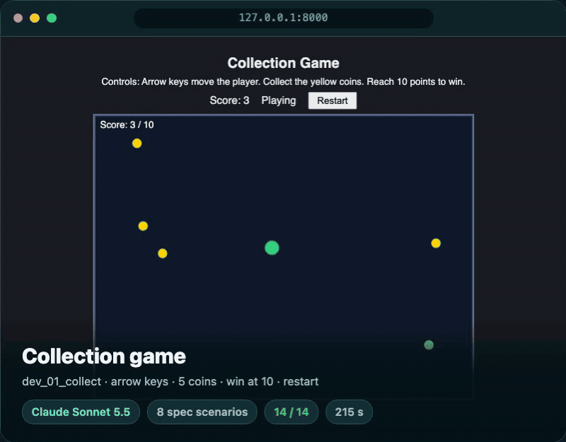</td>
<td width="50%">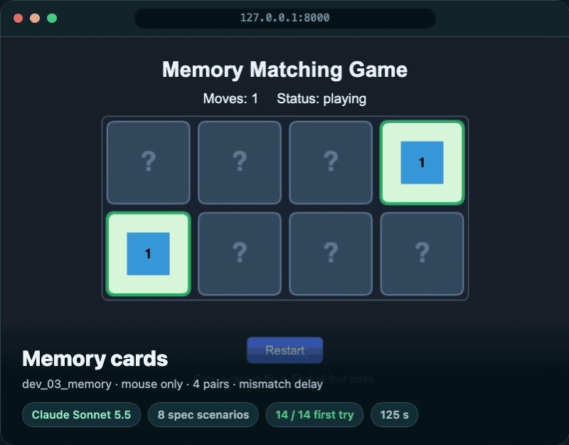</td>
</tr>
<tr>
<td width="50%">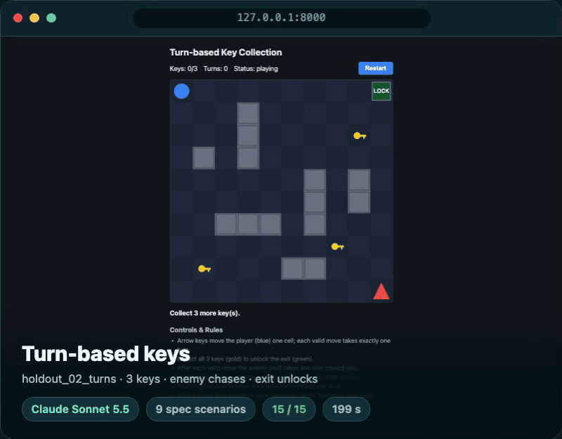</td>
<td width="50%"></td>
</tr>
</table>

<p align="center"><sub>The real games the agent generated from <code>evaluation/specs/</code>, recorded while playing themselves, and a terminal transcript; every number comes from that run's trace.</sub></p>

<a name="how-it-works"></a>


<table>
<tr>
<td width="33%" valign="top">

**Explicit control**

A finite-state machine with legal transitions only; typed, immutable views go to every module; one gateway for every file write, command and install.

</td>
<td width="33%" valign="top">

**Bounded by design**

Time, step, command, retry, recovery and no-progress limits; transient model errors wait (5 s, 15 s, 45 s, 60 s) before retrying; nothing with unknown side effects is ever retried blindly.

</td>
<td width="33%" valign="top">

**Evidence before success**

Success needs passing, evidenced checks for the **current** code and spec, a launch command, and a durable trace. The model can ask for verification; it cannot declare success.

</td>
</tr>
</table>

<a name="verification"></a>


| A scenario from a real run | Result |
|---|---|
| `placePlayerAt(2,2); placeEnemyAt(3,2); key ArrowRight; expect s.status === 'lost'` | ❌ turn-based game: caught "walking into the enemy does not lose", which generic checks had passed |
| `click_cell [0,0]; click_cell [1,0]; click_cell [2,0]; expect s.cards[2].faceUp === false` | ✅ mouse-only memory game: flips are blocked during the mismatch delay, verified by real clicks |

<details>
<summary><b>The success gate, condition by condition</b></summary>

| Required condition | Controller check |
|---|---|
| Correct task | The report's specification digest matches the input |
| Current artifact | The report's workspace revision matches the current workspace |
| Frozen criteria | The acceptance-suite version matches; every criterion has a result |
| Mandatory acceptance | Every mandatory result is PASS with non-empty evidence |
| Observed verification | At least one verification tool operation succeeded in this cycle |
| Launch information | A non-empty launch argument vector was supplied |
| Preserved delivery | `game/` exists; the tracer confirms preservation; the terminal event is durable |

</details>

<details>
<summary><b>Non-browser games (terminal, pygame)</b></summary>

Games are built for the browser unless the specification explicitly asks otherwise. Python games (`python3 main.py`) are verified in **process mode**: the program must start and keep running without a traceback; terminal games are played by typing moves on standard input; graphical games run headless (SDL dummy driver) and their input handling is checked statically, labelled as such in the trace. Spec-derived scenarios apply to browser games only.

</details>

<a name="inside-a-run"></a>


<details>
<summary><b>One tool action through the system</b></summary>

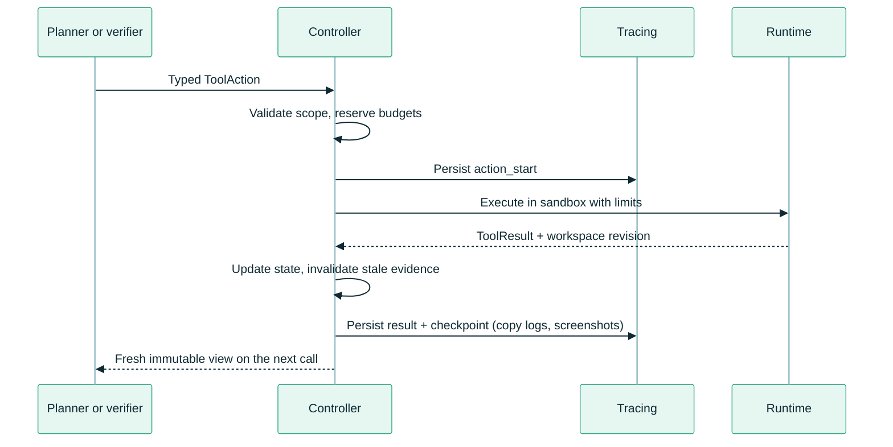

A rejected proposal costs a step but never reaches the runtime. A timeout or uncertain side effect invalidates earlier verification and is never retried blindly. [`TRANSITIONS`](agent/controller.py) is the authoritative state table.

</details>

<a name="run-output"></a>

/, and the trace files run_report.md, events.jsonl, evidence/, verification/, model_usage.jsonl and summary.json.">

> [!NOTE]
> `python -m agent.delivery traces/<run_id>` audits a finished trace: contiguous events, a terminal event, and every referenced screenshot present with a matching hash.

<a name="budgets"></a>


<details>
<summary><b>All limits and their options</b></summary>

| Limit | Default | Option |
|---|---:|---|
| Total runtime, including finalization | 1800 s | `AGENT_MAX_RUNTIME` or `--max-runtime` |
| Work steps | 200 | `--max-steps` |
| Commands and dependency installs | 80 | `--max-commands` |
| Additional retries per operation | 5 | `--max-retries` |
| Wait before the first retry (×3 each time, max 60 s) | 5 s | `--retry-backoff` |
| Global recovery attempts | 20 | `--max-recovery-attempts` |
| Model call timeout | 240 s | `--model-timeout` |
| Command timeout | 90 s | `--command-timeout` |
| Repeated no-progress cycles | 5 | `--max-no-progress` |
| Finalization reserve inside the runtime | 20 s | `--finalization-reserve` |
| Trace infrastructure timeout | 5 s | `--infrastructure-timeout` |

Every module call and tool attempt consumes a step, including rejected proposals and retries; failures never refund counters. After 8 consecutive edits without a verification, the planner requests one itself.

</details>

<a name="team"></a>


<details>
<summary><b>Modules, code and member notes</b></summary>

| Member | Module | Code | Notes |
|:---:|---|---|---|
| **1** | Controller, CLI, configuration, integration | `agent/controller.py` · `agent/integrations.py` | [Team contracts](docs/INTERFACES.md) |
| **2** | Planning, prompts, model client | `agent/planning/` | |
| **3** | Tools, sandbox, processes, dependencies | `agent/tools/` | [notes](docs/members/member3-runtime/) |
| **4** | Acceptance, spec scenarios, browser harness | `agent/verification/` | [notes](docs/members/member4-verification/) |
| **5** | Recovery policy, offline evaluation | `agent/recovery/` · `evaluation/` | [notes](docs/members/member5-recovery/) |
| **6** | Tracing, run report, delivery audit | `agent/tracing/` · `agent/delivery.py` | |

</details>

<details>
<summary><b>Repository map</b></summary>

```text
6203-game-coding-agent/
├── agent/                      SUBMITTED: the agent (no game code); see agent/README.md
│   ├── __main__.py             CLI: python -m agent game_design_prompt.md
│   ├── controller.py           state machine, tool gateway, success gate
│   ├── state.py · config.py    shared contracts, validated limits
│   ├── integrations.py         production wiring of the six modules
│   ├── preflight.py            start-up self-check (python -m agent.preflight)
│   ├── envfile.py              agent.env loading
│   ├── planning/               planner, prompts, parser, LiteLLM client
│   ├── tools/                  sandboxed runtime: files, commands, processes, deps
│   ├── verification/           verifier, spec scenarios, Playwright harness
│   ├── recovery/               error classification and recovery policy
│   ├── tracing/                recorder, run report, model usage
│   └── delivery.py             trace audit
├── game/                       SUBMITTED: the game built in the assessed run (created by the agent)
├── traces/                     SUBMITTED: the full trace of that run (created by the agent)
├── report.pdf                  SUBMITTED: the project report
├── evaluation/                 evaluation specs and run-record report
├── tests/                      298 tests; fixtures/ holds test-only pages
├── docs/                       contracts, integration review, member notes, testing
│   ├── report/                 report source; rebuild: python docs/report/build_report.py
│   └── handoff/member5/        Member 5 hand-off notes
├── assets/                     README artwork; regenerate: python3 assets/src/build_readme_art.py
├── agent.env.example
└── pyproject.toml
```

</details>

<a name="testing"></a>


```bash
python -m pytest -q
```

Tests by area: [docs/testing/README.md](docs/testing/README.md) · Live model results and findings: [docs/testing/LIVE_MODEL_TESTS.md](docs/testing/LIVE_MODEL_TESTS.md)

<br>

